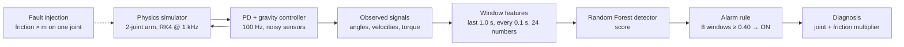

# JointGuard AI

**Detecting and diagnosing abnormal joint friction in a simulated robot arm, using only the signals its controller already has.**

JointGuard AI is an independent research project by **Tuan Anh Nguyen**. It simulates a two-joint robot arm from its equations of motion, injects friction faults in a controlled way, and trains machine-learning models that:

1. **detect** when one joint's friction rises abnormally, without raising an alarm when a healthy arm simply carries a heavier load or moves faster, and
2. **diagnose** the fault once the alarm is on: which joint, and roughly how much its friction has increased.

> **Scope.** All data is simulated, and nothing here has been validated on a physical robot. Increased friction is one way of modelling a fault; it does not identify a physical cause. This is anomaly detection and diagnosis, not prediction of remaining useful life.

| | |
|---|---|
| Project web page (interactive demo) | https://jointguardai.vercel.app/ |
| Technical report (PDF) | [`reports/latex/jointguard_report.pdf`](reports/latex/jointguard_report.pdf). LaTeX source: [`jointguard_report.tex`](reports/latex/jointguard_report.tex) |
| Detailed results report | [`reports/standard/report_en.md`](reports/standard/report_en.md) (English), [`report_vi.md`](reports/standard/report_vi.md) (Vietnamese) |
| Vietnamese README | [`README_vi.md`](README_vi.md) |

---

## Contents

- [Research question](#research-question)
- [Results at a glance](#results-at-a-glance)
- [How it works](#how-it-works)
- [Evaluation protocol](#evaluation-protocol)
- [Limitations](#limitations)
- [Repository structure](#repository-structure)
- [Installation](#installation)
- [Quick start](#quick-start)
- [All commands](#all-commands)
- [Desktop demo](#desktop-demo)
- [Data availability and reproducibility](#data-availability-and-reproducibility)
- [Conventions](#conventions)
- [Next steps](#next-steps)
- [Background and use of AI](#background-and-use-of-ai)
- [License](#license)

---

## Research question

Rising friction in a joint is an early sign of mechanical trouble. It makes the controller work harder and the arm lag behind its target. But a healthy arm that **carries more weight** also needs more torque, and a healthy arm that **moves faster** also lags more. A detector that reacts to any increase would produce false alarms in normal operation.

> *Using only joint torque and tracking error, can a model detect that one joint's friction has risen abnormally, without false alarms when a healthy arm carries a heavier load or moves faster? Once it raises an alarm, can it identify the joint and estimate how much its friction has risen?*

The wider problem has three parts that need different evidence:

| Question | Status in this project |
|---|---|
| **Detect:** is a joint behaving abnormally? | Done, in simulation |
| **Diagnose:** which joint, and how much? | Done, in simulation |
| **Estimate wear:** how long until failure? | Not addressed. It needs run-to-failure data, which injected faults cannot provide. |

---

## Results at a glance

All numbers come from `results/standard/` and were produced by the code in this repository (seed `20261024`).

**Detection.** The **test** set uses conditions inside the training range. The **stress** set is held out and was never used for training or tuning: heavier payloads (2–3 kg), faster motion, and a trajectory type the model never saw.

| Set | Detector | Faulty runs detected | False alarms / healthy min | Healthy runs with a false alarm | Median delay | Window F1 |
|---|---|---|---|---|---|---|
| Test | **Random Forest** | **32 / 32** | **0.21** | 0 / 16 | **1.5 s** | **0.82** |
| Test | Error-threshold baseline | 16 / 32 | 0.31 | 0 / 16 | 2.7 s | 0.43 |
| Stress | Random Forest | 26 / 40 | 3.88 | 15 / 20 | 1.8 s | 0.57 |
| Stress | Error-threshold baseline | 17 / 40 | 2.83 | 14 / 20 | 3.5 s | 0.39 |

**Diagnosis**, on faulty runs the detector caught:

| Set | When | Right joint | Median error of friction multiplier |
|---|---|---|---|
| Test | when the alarm turns on | 30 / 32 | 0.36× |
| Test | 2 s later (alarm still on) | 23 / 23 | 0.20× |
| Stress | when the alarm turns on | 23 / 26 | 0.53× |

**What this means**

- Inside the training range, the detector catches every fault and clearly beats a detector that only looks at error size.
- **Outside the training range, it fails.** It mistakes heavier loads and faster motion for friction. This negative result is reported, not tuned away.
- The friction estimate is rough. Estimates are pulled toward the middle of the training range, so it separates moderate from severe faults but does not measure friction precisely.
- On a false alarm, the diagnosis is also wrong.

---

## How it works



### 1. Simulation (`src/dynamics.py`, `src/simulator.py`)

The arm moves in a vertical plane and follows

$$M(q)\,\ddot q + C(q,\dot q)\,\dot q + G(q) + \tau_f(\dot q) = \tau_{\text{applied}}$$

- The state is integrated with fourth-order Runge–Kutta at 1 ms. The arm's motion only comes from this equation; it is never copied from the target path.
- A tip payload is merged into link 2, so it changes both inertia and gravity.
- Physics is checked by automated tests: energy is conserved without friction, friction removes energy, gravity matches the gradient of potential energy, and halving the step changes angles by at most 8.2 × 10⁻⁹ rad.

| Parameter | Link 1 | Link 2 |
|---|---|---|
| Length [m] | 0.60 | 0.50 |
| Mass [kg] | 8.0 | 5.0 |
| Torque limit [N·m] | 150 | 60 |
| Viscous friction b [N·m·s/rad] | 2.0 | 1.2 |
| Coulomb friction τc [N·m] | 3.0 | 2.0 |

### 2. Controller (`src/controller.py`)

A PD controller with gravity compensation runs at 100 Hz on noisy measurements. It knows the nominal arm and the declared payload. It **does not know or compensate friction**, so rising friction shows up as larger tracking error and torque. That is the signal the models learn from.

### 3. Fault model (`src/faults.py`, `src/scenarios.py`)

$$\tau_f = m\left(b\,\dot q + \tau_c \tanh\frac{\dot q}{0.02}\right)$$

- A fault multiplies one joint's friction by m. A window is labelled anomalous when **m ≥ 1.5**. This rule was fixed before any data was generated and never uses tracking error.
- Faults can be mild jumps (×1.6–2.2), severe jumps (×2.8–4.0) or gradual ramps (to ×2.2–4.0 over 6–12 s).
- Healthy friction varies by ±15 % between runs.

### 4. Features (`src/features.py`)

Every 0.1 s, the last 1.0 s of data is summarised into 12 numbers per joint: torque size and variation, tracking-error size and peak, velocity error, target speed and acceleration, and the key feature, **tracking error along the direction of motion**:

$$\bar e_{\text{dir}} = \frac{1}{N}\sum_{k} e_k \tanh\frac{\dot q_{\text{des},k}}{0.05}$$

Friction always opposes motion, so it makes the arm lag *in the direction it is moving*. Extra payload mostly adds a gravity load, which the controller already compensates.

Features are strictly causal. Time, run IDs, true payload, friction values and labels are never inputs; tests enforce this.

### 5. Detector and alarm (`src/training.py`, `src/alarm.py`)

- A Random Forest (200 trees) was selected from 32 configurations by validation average precision (0.927).
- The alarm turns on after **8 consecutive windows** score ≥ **0.40** (0.8 s of evidence), and turns off after 5 consecutive windows below.
- These values were chosen on validation data to maximise F1 with at most 0.5 false alarms per minute.
- The baseline uses the same alarm rule on a normalised tracking-error score.

### 6. Diagnosis (`src/diagnosis.py`)

- Once the alarm is on, two more Random Forests read the same features: one classifies the faulty joint, one estimates the friction multiplier.
- They were trained only on fault windows from the training set and reuse the detector's settings, with no extra tuning.
- Output is averaged over up to the last 20 above-threshold windows. It is shown only while the alarm is on, for example `Joint 2 - friction increase: 213% (x3.1)`.

---

## Evaluation protocol

- **Group-based splits.** Runs come in groups that share a trajectory, payload and healthy friction. Train/validation/test (60/20/20) is split by group, so near-duplicate runs never appear on both sides. The split file is written before training.
- **No test-set tuning.** Every choice of window, hyper-parameters, threshold and alarm rule uses training and validation data only.
- **Out-of-distribution stress test**, reported separately and never averaged with the test set.
- **Event-level metrics.**
  - An alarm is one off-to-on transition. A false alarm is one that starts before the fault.
  - Delay is measured from the moment the label switches.
  - An alarm that was already on before the fault never counts as a detection.
- **31 automated tests** (`tests/`) cover the physics, data leakage, causality, identical online and offline features, the evaluation rules and the diagnosis tracker.

---

## Limitations

- 100 % simulated. The arm has rigid links and no motor, gearbox, backlash or temperature effects. Torque is a simulated signal, not measured motor current.
- One fault type (friction), on one joint at a time.
- The controller knows the exact nominal parameters of the arm.
- Each test scenario has 4–8 runs, and no confidence intervals are computed.
- The models do not generalise to loads and speeds outside the training range.
- The diagnosis gives a joint and a friction level, not a cause. Its estimate is compressed toward the middle of the range.

---

## Repository structure

```
configs/default.json        every parameter (robot, friction, controller, scenarios, training), SI units
src/
  config.py                 config loading; refuses to overwrite earlier results
  dynamics.py               kinematics, M(q), C(q,q̇)q̇, G(q), friction, forward dynamics
  controller.py             PD + gravity compensation + torque limits
  trajectory.py             smooth sinusoidal and quintic point-to-point trajectories
  faults.py                 fault schedules and labelling rule
  simulator.py              closed loop: RK4 1 kHz, control 100 Hz, sensors 100 Hz
  scenarios.py              scenario sampling (healthy / mild / severe / gradual, joint 1/2, stress)
  dataset.py                headless batch generation, manifests, numerical-failure log
  splits.py                 group-based train/val/test split
  features.py               window features (shared by offline training and the online demo)
  alarm.py                  alarm persistence rule
  training.py               Random Forest + baseline, validation-based selection
  evaluation.py             window- and event-level metrics
  diagnosis.py              joint classifier, friction regressor, online diagnosis tracker
  online.py                 streaming detector used by the demo
  gui/app.py                Pygame desktop demo
  plots.py                  figures
  report.py, report_en.py   auto-generated reports (Vietnamese / English)
scripts/                    runnable steps: python -m scripts.<name>
tests/                      pytest suite
data/<name>/                manifest.csv, split_manifest.csv, generation_info.json
                            (signals/, truth/, features/ are regenerated locally, see below)
models/standard/            trained detector, baseline and diagnosis models + model card
results/standard/           metrics, per-run and per-window tables, figures
reports/standard/           detailed reports (report_en.*, report_vi.*)
reports/latex/              LaTeX technical report and its figures
web/                        project web page (index.html) and recorded demo runs (demo_runs.json)
docs/                       study guide and demo script (Vietnamese)
```

---

## Installation

Requires Python 3.10+. The reported results were produced with Python 3.13 and the exact versions in `requirements.txt`. Other versions should run but may give slightly different numbers.

**Windows (PowerShell)**

```powershell
py -3 -m venv .venv
.\.venv\Scripts\Activate.ps1      # if blocked: Set-ExecutionPolicy -Scope CurrentUser RemoteSigned
python -m pip install --upgrade pip
pip install -r requirements.txt
```

**macOS / Linux**

```bash
python3 -m venv .venv
source .venv/bin/activate
pip install -r requirements.txt
```

---

## Quick start

All commands run from the repository root with the virtual environment active.

```bash
python -m pytest -q                                   # 31 tests
python -m scripts.run_demo --model models/standard    # desktop demo with the trained models
python -m scripts.run_pipeline --mode smoke           # whole pipeline on a tiny dataset (~1–2 min)
```

The demo needs only `models/standard/`, which is included. No raw data is required.

---

## All commands

| Step | Command |
|---|---|
| Physics checks | `python -m scripts.check_physics` |
| Full pipeline (15–40 min) | `python -m scripts.run_pipeline --mode standard` |
| Generate data | `python -m scripts.generate_dataset --mode standard` |
| Split (before training) | `python -m scripts.make_splits --data data/standard` |
| Features | `python -m scripts.build_features --data data/standard` |
| Train detector + baseline | `python -m scripts.train --data data/standard --tag standard` |
| Evaluate detector (test + stress) | `python -m scripts.evaluate --data data/standard --model models/standard --tag standard` |
| Train diagnosis | `python -m scripts.train_diagnosis --data data/standard --model models/standard` |
| Evaluate diagnosis | `python -m scripts.evaluate_diagnosis --data data/standard --model models/standard --results results/standard` |
| Figures | `python -m scripts.make_figures --results results/standard` |
| Diagnosis figures | `python -m scripts.make_diagnosis_figures --results results/standard --demo web/demo_runs.json` |
| Reports (Markdown + Word) | `python -m scripts.make_report --results results/standard --model models/standard --out reports/standard --lang en` (or `--lang vi`) |
| Export runs for the web page | `python -m scripts.export_web_demo --model models/standard --out web/demo_runs.json` |
| Desktop demo | `python -m scripts.run_demo --model models/standard` |
| Headless demo check (screenshots) | `python -m scripts.demo_headless_check --model models/standard` |

**Nothing is overwritten silently.** If an output already exists, the script stops. Use a new `--name` / `--tag`, or pass `--overwrite` on purpose. For example, to rerun everything under a new name:

```bash
python -m scripts.generate_dataset --mode standard --name standard_v2
python -m scripts.make_splits --data data/standard_v2
python -m scripts.build_features --data data/standard_v2
python -m scripts.train --data data/standard_v2 --tag standard_v2
python -m scripts.evaluate --data data/standard_v2 --model models/standard_v2 --tag standard_v2
```

---

## Desktop demo

`python -m scripts.run_demo --model models/standard` opens a real-time Pygame window.

- **Left:** the arm, its target path (dotted) and its actual path.
- **Right:** joint torque, tracking error and the model score with its threshold.
- **Bottom:** an **AI PREDICTION** panel (status, score, and the diagnosis while the alarm is on), and a separate **SIMULATOR GROUND TRUTH** panel for the experimenter. The AI never reads the ground-truth panel.

| Key | Action |
|---|---|
| Space | pause / resume |
| R | reset the run, the window buffer and the alarm |
| 1 | healthy (friction back to normal) |
| 2 / 3 | sudden ×3 friction on joint 1 / joint 2 |
| 4 | joint 1 friction ramps to ×3.5 over 10 s |
| L | cycle payload 0.5 → 1.5 → 2.0 kg (resets) |
| V | toggle speed normal ↔ fast (resets) |
| S | screenshot to `results/screenshots/` |
| Esc | quit and save a log to `results/demo_logs/` |

Fault keys only change the friction parameter inside the physics model. Alarms come only from the trained model.

Simulated time follows the wall clock. If the computer cannot keep up, the window shows **NOT REAL-TIME**. On macOS, run it from Terminal if no window appears. On a machine without a display, use `demo_headless_check`.

The **web page** in `web/` replays recorded runs that were produced by the same simulator and models (`export_web_demo`).

- It is published at https://jointguardai.vercel.app/ (the `web/` folder is deployed as a static site).
- To view it locally, serve the folder with `python -m http.server -d web 8000` and open `http://localhost:8000`. Opening the file directly does not work, because the browser blocks the page from loading `demo_runs.json`.

---

## Data availability and reproducibility

- The repository includes the manifests (`manifest.csv`, `split_manifest.csv`, `generation_info.json`), the trained models, all results, figures and reports.
- The raw signals (`data/*/signals`, `truth`, `features`) are **not** in the repository, to keep it small. They can be regenerated: every run's seed and parameters are stored in the manifest. With the same seed, configuration and library versions, regeneration gives identical signals; a test checks this at run level.

```bash
python -m scripts.generate_dataset --mode standard
python -m scripts.build_features --data data/standard
```

Retraining or re-evaluating needs those regenerated files. The demo, the web page and the reports do not.

- Seed `20261024`
- Python 3.13
- NumPy 2.5.4, pandas 3.1.0, scikit-learn 1.9.1

---

## Conventions

- The origin is at joint 1. x points right, y points up, and gravity acts along −y. The arm moves in a vertical plane.
- `q1` is link 1's angle from +x. `q2` is link 2's angle **relative to link 1**. Angles are counter-clockwise positive, in radians.
- Joint torque is positive in the direction of positive angle, in N·m. All units are SI.
- Tracking error: `e = q_des − q_meas`.

---

## Next steps

- Add physics-informed features, such as the residual between measured torque and the torque predicted by the nominal model, so that load and friction separate by construction. Then re-test on a fresh stress set.
- Detect out-of-range operating conditions and report "uncertain" instead of raising an alarm.
- Model motors and gearboxes, and compare with data from a real arm.
- Use run-to-failure data to study gradual degradation, the evidence needed for wear estimation.
- Add group-wise bootstrap confidence intervals and cross-validation.

---

## Background and use of AI

This project grew out of a summer internship in a university control and automation lab, where I worked with industrial robot arms and their control software.

I formulated the research question and the fault definition, specified the simulation and evaluation design, ran the experiments and reviewed the results. The code, experiments and reports were built with help from an AI coding assistant (Claude), following my questions and decisions. Every number in this repository's reports is read from its result files.

---

## License

[MIT](LICENSE) © 2026 Tuan Anh Nguyen
