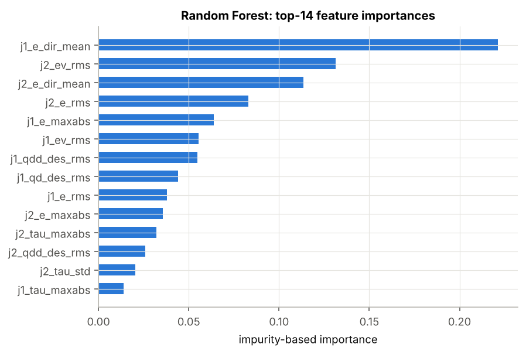
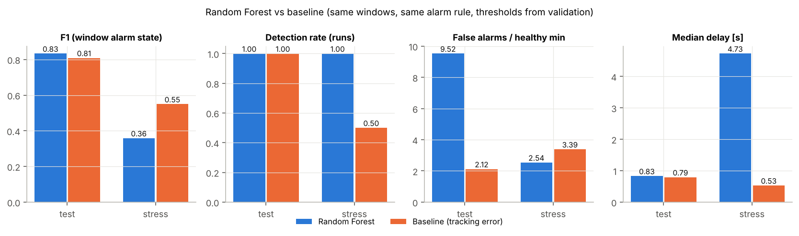
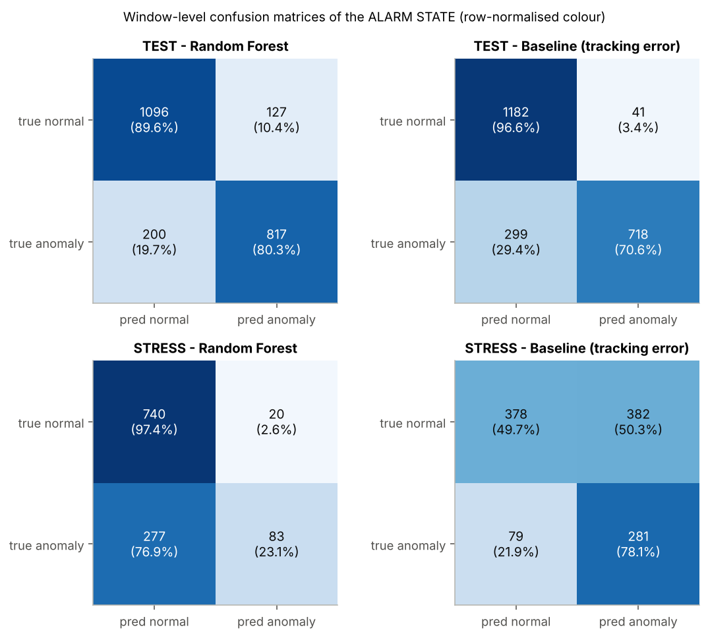
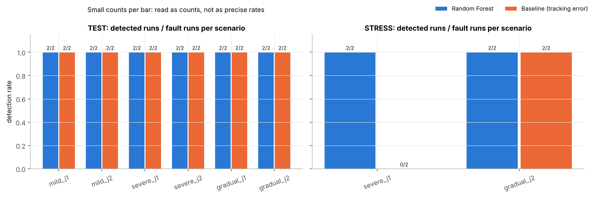
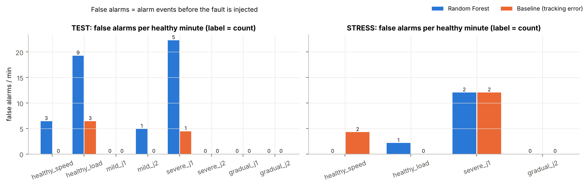
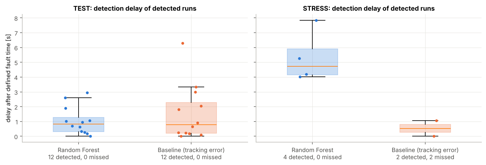
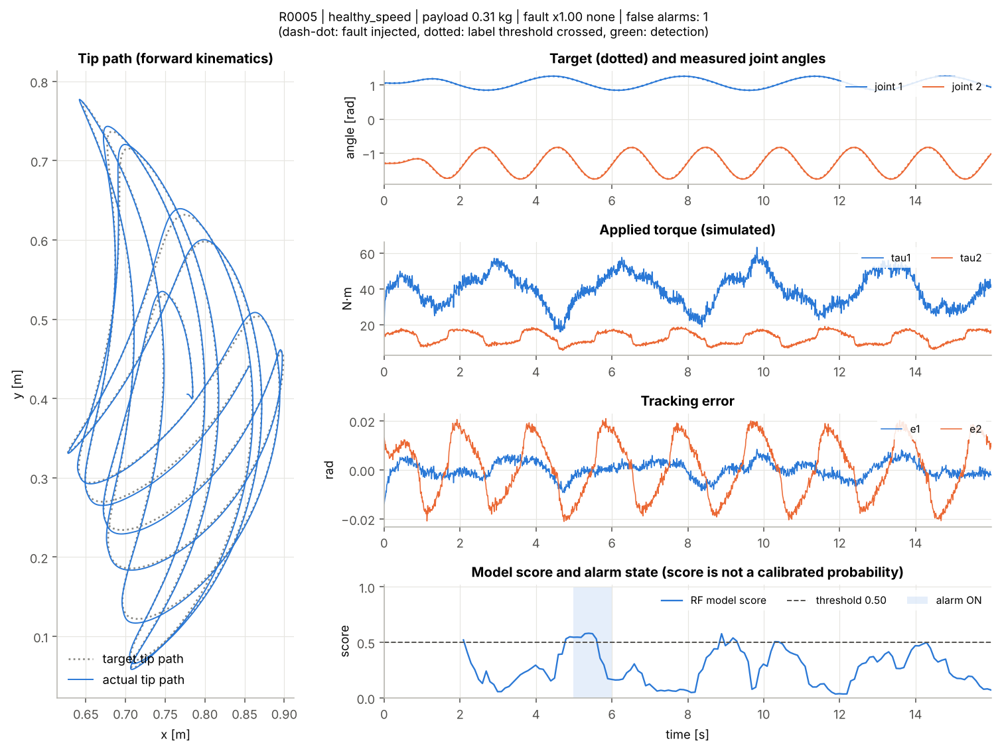
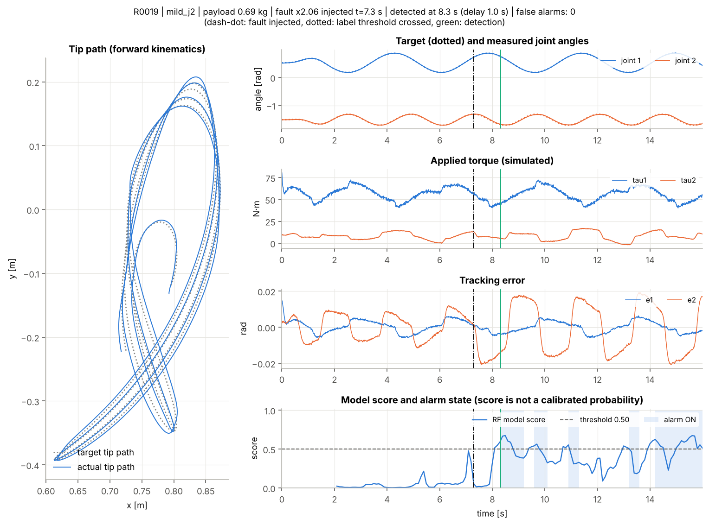
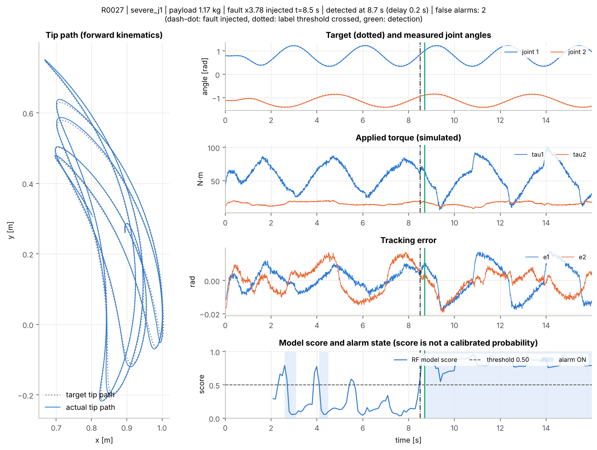
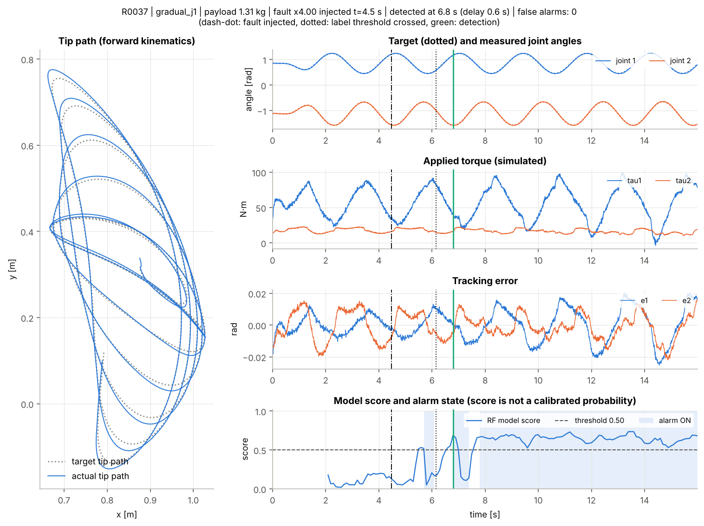

# Báo cáo: Phát hiện bất thường ma sát khớp trên robot 2-DOF bằng mô phỏng động lực học và Machine Learning

*Bộ dữ liệu: `data/smoke` (chế độ `smoke`), mô hình: `models/smoke`. Báo cáo được sinh tự động bởi `python -m scripts.make_report` từ kết quả đã chạy; mọi con số đều đọc từ file kết quả.*

**ĐÂY LÀ BÁO CÁO SMOKE**: dữ liệu rất nhỏ, chỉ dùng để kiểm tra pipeline chạy xuyên suốt. Không dùng các con số dưới đây để kết luận.

**Lưu ý quan trọng.** Toàn bộ dữ liệu được tạo bằng mô phỏng. Ma sát tăng là cách mô hình hóa một bất thường; nó không chứng minh nguyên nhân duy nhất là khô dầu. Kết quả chưa được xác nhận trên robot thật. Phát hiện bất thường hiện tại không tương đương với dự báo thời điểm hỏng hay tuổi thọ còn lại. Đồ thị mô phỏng trông giống tín hiệu thật không phải là bằng chứng xác thực vật lý.

**Minh bạch về công cụ.** Mã nguồn, thí nghiệm và báo cáo này được xây dựng với sự hỗ trợ của trợ lý AI (Claude) theo yêu cầu và định hướng của tác giả. Khi trình bày, cần ghi rõ phần nào do mình tự thực hiện, tự kiểm tra hoặc tự sửa đổi.

## 1. Câu hỏi nghiên cứu

Chỉ từ mô-men khớp (tín hiệu mô phỏng) và sai số bám quỹ đạo, hệ thống có phát hiện được ma sát của một khớp tăng bất thường không? Đồng thời, nó có tránh được báo nhầm khi robot khỏe chạy nhanh hơn hoặc mang tải nặng hơn không? Hai trường hợp này cũng làm mô-men và sai số tăng, nên đây là phần khó của bài toán.

Định nghĩa bất thường được chọn trước khi sinh dữ liệu: ma sát của một khớp (cả hệ số nhớt b và Coulomb τc) cao hơn giá trị khỏe của lần chạy đó ít nhất 1.5 lần (tức ≥ +50%). Nhãn không dựa vào sai số bám.

## 2. Mô hình cơ học và giả định

Robot phẳng hai khớp quay, chuyển động trong mặt phẳng thẳng đứng. Hệ tọa độ gốc đặt tại khớp 1, trục x hướng sang phải, trục y hướng lên, trọng lực theo −y. q1 là góc khâu 1 so với trục +x; q2 là góc tương đối của khâu 2 so với khâu 1. Chiều dương là ngược chiều kim đồng hồ. Đơn vị SI (m, kg, s, rad, N·m).

Phương trình chuyển động: `M(q)·q̈ + C(q,q̇)·q̇ + G(q) + τf(q̇) = τ_applied + τ_external` (trong thí nghiệm này τ_external = 0). Gia tốc được tính bằng cách giải hệ tuyến tính 2×2 (khử Gauss), không nghịch đảo ma trận. Trạng thái được tích phân bằng RK4 với bước 1 ms.

| Tham số | Khâu 1 | Khâu 2 |
|---|---|---|
| Chiều dài l [m] | 0.6 | 0.5 |
| Khối lượng m [kg] | 8.0 | 5.0 |
| Khoảng cách tới trọng tâm lc [m] | 0.3 | 0.25 |
| Mô-men quán tính quanh trọng tâm I [kg·m²] | 0.24 | 0.104 |
| Quán tính rotor quy đổi [kg·m²] | 0.15 | 0.08 |
| Giới hạn khớp [rad] | [-0.6, 2.4] | [-2.7, -0.15] |
| Giới hạn mô-men [N·m] | 150.0 | 60.0 |
| Ma sát nhớt danh định b [N·m·s/rad] | 2.0 | 1.2 |
| Ma sát Coulomb danh định τc [N·m] | 3.0 | 2.0 |

- Tải ở đầu robot là khối lượng điểm. Nó được gộp vào khâu 2 thành một vật rắn tương đương (khối lượng, trọng tâm, quán tính theo định lý trục song song), nên tác động nhất quán lên cả M(q) và G(q).
- Ma sát mỗi khớp: `τf = b·q̇ + τc·tanh(q̇/ε)` với ε = 0.02 rad/s (Coulomb được làm trơn). Ma sát khỏe của mỗi lần chạy được lấy ngẫu nhiên trong ±15% quanh giá trị danh định.
- Lỗi chỉ nhân b và τc của một khớp trong mô hình vật lý. Bộ điều khiển không biết điều này.
- Giả định chưa mô hình hóa: động cơ, hộp số, khe hở (backlash), độ đàn hồi, nhiệt độ, va chạm, ma sát phụ thuộc tải. Mô-men là tín hiệu mô phỏng, không phải dòng điện đo được.
- Cảm biến: nhiễu Gauss cộng vào góc và vận tốc. Độ lệch chuẩn được lấy ngẫu nhiên cho mỗi lần chạy (góc [0.0002, 0.001] rad, vận tốc [0.002, 0.01] rad/s), cùng một phân bố cho cả lần chạy khỏe và lỗi.

**Kiểm tra vật lý** (`python -m scripts.check_physics`, chi tiết trong `tests/test_physics.py`): động học thuận tại các cấu hình biết trước; M đối xứng và xác định dương; G(q) bằng gradient của thế năng; tải tạo đúng mô-men của khối lượng điểm; cân bằng trọng lực khi đứng yên; năng lượng được bảo toàn khi không có ma sát và mô-men; ma sát làm năng lượng giảm; robot khỏe bám ổn định; không có NaN; mất ổn định số được báo lỗi. Khi giảm bước tích phân từ 1 ms xuống 0,5 ms (có lỗi đột ngột x4, tải 2 kg), sai khác góc lớn nhất là 8.2e-09 rad.

## 3. Bộ điều khiển

Bộ điều khiển là PD kết hợp bù trọng lực, chạy ở 100 Hz (zero-order hold): `τ_req = Kp·(q_des − q_meas) + Kd·(q̇_des − q̇_meas) + Ĝ(q_meas)`, sau đó giới hạn mô-men để có τ_applied. Hệ số Kp = [1500.0, 300.0], Kd = [100.0, 20.0]. Cả τ_req và τ_applied đều được lưu.

- Bộ điều khiển biết thông số danh định của các khâu và tải do người vận hành khai báo. Tải khai báo có thể lệch so với tải thật tối đa ±0.1 kg.
- Nó không biết ma sát (khỏe hay lỗi) và không bù ma sát, nên ma sát tăng thể hiện thành sai số bám và mô-men PD lớn hơn.
- Bộ điều khiển chỉ nhận tín hiệu đo có nhiễu. Hệ số được chọn một lần theo yêu cầu ổn định rời rạc ở 100 Hz và không được chỉnh lại theo kết quả test.
- Bão hòa mô-men: trong miền chuẩn, tỷ lệ chu kỳ bị bão hòa lớn nhất là 0.0000; trong stress test là 0.0000.

## 4. Cách sinh dữ liệu

Dữ liệu được sinh hoàn toàn không cần giao diện (`python -m scripts.generate_dataset --mode smoke`). Mỗi lần chạy dài 16 s. Thời gian khởi động trơn là 2.0 s. Tín hiệu được lấy mẫu ở 100 Hz. Tổng cộng có 56 lần chạy thành công và 0 lần mất ổn định số (được ghi riêng trong `failed_runs.csv` và không bao giờ bị gắn nhãn lỗi cơ khí).

- Quỹ đạo trong miền chuẩn: dao động sin trong không gian khớp. Tâm, biên độ, tần số và pha thay đổi (tần số [0.15, 0.55] Hz). Quỹ đạo vượt giới hạn khớp bị loại khi lấy mẫu.
- Nhóm healthy_speed: nhiều tốc độ, tải trong khoảng danh định [0.3, 0.8] kg. Nhóm healthy_load: tải [0.0, 2.0] kg, tốc độ thấp hơn.
- mild: ma sát nhảy lên x1.6–2.2; severe: x2.8–4.0. Thời điểm bắt đầu lấy ngẫu nhiên trong [5.0, 9.0] s.
- gradual: ma sát tăng tuyến tính từ x1 tới x2.2–4.0 trong 6.0–12.0 s. Nhãn bật tại thời điểm hệ số vượt 1.5. Từ lúc bắt đầu tăng tới lúc đó, nhãn vẫn là 0, nhưng cảnh báo trong giai đoạn này không bị tính là báo nhầm.
- Stress test (giữ riêng, không dùng để huấn luyện hay chỉnh): tải nặng hơn [2.0, 3.0] kg, tần số cao hơn [0.55, 0.75] Hz, và 50% là quỹ đạo chuyển điểm trơn (quintic), một kiểu quỹ đạo chưa từng xuất hiện khi huấn luyện.
- Mỗi nhóm (thí nghiệm gốc) gồm 2 lần chạy cùng quỹ đạo, tải và ma sát khỏe. Các lần chạy khác nhau ở nhiễu, độ lệch ban đầu và thời điểm lỗi. Một nhóm luôn nằm trọn trong một tập.
- Tín hiệu quan sát (`signals/`) và ground truth (`truth/`, `manifest.csv`) được lưu tách riêng. Seed và toàn bộ tham số của từng lần chạy nằm trong manifest, nên có thể tái tạo từng lần chạy.

| Kịch bản | train | val | test | stress |
|---|---|---|---|---|
| gradual_j1 | 2 | 2 | 2 | 0 |
| gradual_j2 | 2 | 2 | 2 | 2 |
| healthy_load | 2 | 2 | 2 | 2 |
| healthy_speed | 2 | 2 | 2 | 2 |
| mild_j1 | 2 | 2 | 2 | 0 |
| mild_j2 | 2 | 2 | 2 | 0 |
| severe_j1 | 2 | 2 | 2 | 2 |
| severe_j2 | 2 | 2 | 2 | 0 |

## 5. Đặc trưng và mô hình AI

Đặc trưng được tính trên cửa sổ quá khứ dài 1.0 s (thử 0,5 s và 1 s, chọn bằng validation), cập nhật mỗi 0.1 s. Chỉ dùng dữ liệu tới thời điểm dự đoán, không có bộ lọc hai chiều. Với mỗi khớp, đặc trưng gồm: RMS, độ lệch chuẩn và cực đại |mô-men|; RMS tốc độ thay đổi mô-men; mô-men trung bình theo hướng chuyển động mục tiêu; RMS và cực đại |sai số vị trí|; sai số vị trí trung bình theo hướng chuyển động (`mean(e·tanh(q̇_des/0.05))`, nhạy với lực cản của ma sát); RMS sai số vận tốc; RMS vận tốc và gia tốc mục tiêu; góc mục tiêu trung bình. Tổng cộng có 24 đặc trưng.

Thời gian tuyệt đối, run_id, tải thật, hệ số ma sát và nhãn không bao giờ được đưa vào đặc trưng. Có kiểm thử tự động cho việc này, cho tính nhân quả, và cho việc đặc trưng online và offline giống hệt nhau.

Mô hình là Random Forest (scikit-learn 1.9.1). Tham số tốt nhất trên validation (average precision = 0.952): `{'n_estimators': 200, 'max_depth': 14, 'min_samples_leaf': 8, 'max_features': 0.5, 'class_weight': None}`. Có 32 tổ hợp được thử. Cửa sổ trộn nhãn bị loại khi huấn luyện. Ngưỡng điểm dự đoán là 0.5. Cảnh báo bật sau 3 cửa sổ dương liên tiếp và tắt sau 5 cửa sổ âm liên tiếp. Hai giá trị này được chọn trên validation để tối đa F1, với điều kiện số báo nhầm ≤ 0.5/phút. `predict_proba` được gọi là **điểm dự đoán của mô hình**, không phải xác suất đã hiệu chuẩn.

**Baseline:** điểm = max_j(RMS sai số vị trí khớp j / tham chiếu_j). Tham chiếu là phân vị 95% trên các cửa sổ khỏe của tập train (0.0087 và 0.0199 rad). Cửa sổ là 1.0 s, ngưỡng x0.8, và cảnh báo bật sau 1 cửa sổ liên tiếp. Baseline dùng cùng quy tắc chọn trên validation và cùng quy tắc cảnh báo như Random Forest.

*Hình: Độ quan trọng đặc trưng (impurity-based) của Random Forest.*

## 6. Thiết kế đánh giá

- Dữ liệu được chia theo nhóm thí nghiệm (60/20/20, phân tầng theo kịch bản), và file split được tạo trước khi huấn luyện. Mọi lựa chọn đặc trưng, tham số và ngưỡng chỉ dùng train/validation.
- Test thông thường và stress test được báo cáo riêng, không gộp thành một điểm chung.
- Giám sát bắt đầu sau 2.0 s (hết giai đoạn khởi động trơn). Trước đó giao diện hiển thị WARMING UP.
- Một cảnh báo = một lần chuyển trạng thái từ tắt sang bật. Báo nhầm = cảnh báo bắt đầu trước khi lỗi được bơm vào. Số báo nhầm được chia cho số phút robot khỏe.
- Độ trễ = thời điểm cảnh báo hợp lệ đầu tiên − thời điểm lỗi được định nghĩa (nhãn bật). Một cảnh báo nhầm đã bật từ trước và kéo dài không được tính là phát hiện. Với lỗi tăng dần, cảnh báo bắt đầu sau khi ma sát bắt đầu tăng và vẫn bật tại thời điểm nhãn chuyển sang 1 được tính là phát hiện sớm với độ trễ 0.
- Chỉ số theo cửa sổ (Precision/Recall/F1) so sánh trạng thái cảnh báo với nhãn trên mọi cửa sổ, kể cả giai đoạn chuyển tiếp. Đây là lý do recall theo cửa sổ thấp hơn tỷ lệ phát hiện theo lần chạy: các cửa sổ trong khoảng trễ phát hiện bị tính là bỏ sót.

## 7. Kết quả thực nghiệm

RF = Random Forest; TV = trung vị; F1 thô = F1 của quyết định từng cửa sổ trước quy tắc duy trì.

### 7.1 Test thông thường (trong miền)

Gồm 16 lần chạy, 1.9 phút robot khỏe và 12 lần chạy có lỗi.

| Bộ phát hiện | Precision | Recall | F1 | F1 thô | Báo nhầm /phút | Lần khỏe có báo nhầm | Phát hiện | Bỏ sót | Trễ TV [s] | Trễ P90 [s] | Trễ max [s] |
|---|---|---|---|---|---|---|---|---|---|---|---|
| RF | 0.87 | 0.80 | 0.83 | 0.83 | 9.52 | 4/4 | 12/12 | 0 | 0.8 | 2.5 | 2.9 |
| Baseline | 0.95 | 0.71 | 0.81 | 0.78 | 2.12 | 2/4 | 12/12 | 0 | 0.8 | 3.3 | 6.3 |

### 7.2 Stress test (điều kiện giữ riêng)

Gồm 8 lần chạy, 1.2 phút robot khỏe và 4 lần chạy có lỗi.

| Bộ phát hiện | Precision | Recall | F1 | F1 thô | Báo nhầm /phút | Lần khỏe có báo nhầm | Phát hiện | Bỏ sót | Trễ TV [s] | Trễ P90 [s] | Trễ max [s] |
|---|---|---|---|---|---|---|---|---|---|---|---|
| RF | 0.81 | 0.23 | 0.36 | 0.33 | 2.54 | 1/4 | 4/4 | 0 | 4.7 | 7.1 | 7.8 |
| Baseline | 0.42 | 0.78 | 0.55 | 0.52 | 3.39 | 2/4 | 2/4 | 2 | 0.5 | 1.0 | 1.1 |

*Hình: So sánh Random Forest và baseline trên test và stress.*

*Hình: Ma trận nhầm lẫn theo cửa sổ (trạng thái cảnh báo).*

### 7.3 Theo mức lỗi và khớp lỗi

**TEST**

| Kịch bản | Số lần chạy | RF phát hiện | RF trễ TV [s] | RF báo nhầm | BL phát hiện | BL trễ TV [s] | BL báo nhầm |
|---|---|---|---|---|---|---|---|
| gradual_j1 | 2 | 2/2 | 0.3 | 0 | 2/2 | 0.1 | 0 |
| gradual_j2 | 2 | 2/2 | 2.8 | 0 | 2/2 | 3.2 | 0 |
| healthy_load | 2 | — | — | 9 | — | — | 3 |
| healthy_speed | 2 | — | — | 3 | — | — | 0 |
| mild_j1 | 2 | 2/2 | 0.8 | 0 | 2/2 | 1.9 | 0 |
| mild_j2 | 2 | 2/2 | 1.5 | 1 | 2/2 | 3.6 | 0 |
| severe_j1 | 2 | 2/2 | 0.6 | 5 | 2/2 | 0.4 | 1 |
| severe_j2 | 2 | 2/2 | 0.3 | 0 | 2/2 | 0.2 | 0 |

**STRESS**

| Kịch bản | Số lần chạy | RF phát hiện | RF trễ TV [s] | RF báo nhầm | BL phát hiện | BL trễ TV [s] | BL báo nhầm |
|---|---|---|---|---|---|---|---|
| gradual_j2 | 2 | 2/2 | 4.6 | 0 | 2/2 | 0.5 | 0 |
| healthy_load | 2 | — | — | 1 | — | — | 0 |
| healthy_speed | 2 | — | — | 0 | — | — | 2 |
| severe_j1 | 2 | 2/2 | 6.0 | 2 | 0/2 | — | 2 |

*Hình: Tỷ lệ phát hiện theo kịch bản (nhãn = số lần phát hiện / số lần có lỗi).*

*Hình: Báo nhầm theo kịch bản.*

*Hình: Phân bố độ trễ của các lần được phát hiện, kèm số lần bỏ sót.*

*Hình: Ví dụ lần chạy R0005 trong tập test: quỹ đạo, mô-men, sai số, điểm dự đoán.*

*Hình: Ví dụ lần chạy R0019 trong tập test: quỹ đạo, mô-men, sai số, điểm dự đoán.*

*Hình: Ví dụ lần chạy R0027 trong tập test: quỹ đạo, mô-men, sai số, điểm dự đoán.*

*Hình: Ví dụ lần chạy R0037 trong tập test: quỹ đạo, mô-men, sai số, điểm dự đoán.*

## 8. Phân tích báo nhầm và bỏ sót

Trong test, Random Forest có 18 báo nhầm, ở các lần chạy R0005 (healthy_speed), R0006 (healthy_speed), R0011 (healthy_load), R0012 (healthy_load), R0020 (mild_j2), R0027 (severe_j1), R0028 (severe_j1), và bỏ sót 0 lần chạy có lỗi. Độ trễ lớn nhất trong test là 2.9 s.

*Các nhận xét định tính dưới đây được viết khi phân tích lần chạy standard đầu tiên; nếu chạy lại với cấu hình khác, hãy đối chiếu chúng với các bảng số (được cập nhật tự động).*

Phân tích stress test theo kiểu quỹ đạo (tải 2–3 kg trong cả hai kiểu):

| Bộ phát hiện | Quỹ đạo | Số lần chạy | Báo nhầm | Phát hiện |
|---|---|---|---|---|
| rf | p2p | 4 | 1 (1.82/phút) | 2/2 |
| rf | sinusoid | 4 | 2 (3.16/phút) | 2/2 |
| baseline | p2p | 4 | 0 (0.00/phút) | 2/2 |
| baseline | sinusoid | 4 | 4 (6.32/phút) | 0/2 |

- Trong miền chuẩn, Random Forest đạt F1 0.83, so với 0.81 của baseline. Nó phát hiện 12/12 lần chạy có lỗi, so với 12/12 của baseline. Baseline chỉ nhìn độ lớn sai số, nên muốn ít báo nhầm khi robot khỏe chạy nhanh thì ngưỡng phải cao, và khi đó nó bỏ sót phần lớn lỗi mild và lỗi ở khớp 1 (xem bảng 7.3). Random Forest kết hợp thêm thông tin về chuyển động mục tiêu và sai số theo hướng chuyển động, nên tách được hai trường hợp tốt hơn trong miền đã huấn luyện.
- Ngoài miền (stress), cả hai phương pháp đều suy giảm rõ. Random Forest có 2.54 báo nhầm/phút robot khỏe, và 1/4 lần chạy khỏe có ít nhất một báo nhầm. Tải nặng hơn và tốc độ cao hơn mức đã thấy khi huấn luyện bị mô hình hiểu nhầm thành ma sát. Đây là câu trả lời trực tiếp (và tiêu cực) cho vế 'tránh báo nhầm khi tải lớn hơn' của câu hỏi nghiên cứu, khi tải vượt ra ngoài phạm vi huấn luyện.
- Với lỗi trên quỹ đạo sin trong stress test, nếu cảnh báo đã bật nhầm từ trước khi lỗi xuất hiện, quy tắc đánh giá không tính đó là phát hiện. Vì vậy số lần phát hiện thấp ở nhóm này chủ yếu phản ánh báo nhầm kéo dài, không phải mô hình 'không thấy' lỗi.
- Khi tỷ lệ báo nhầm cao, một phần 'phát hiện' sau thời điểm lỗi có thể chỉ là trùng hợp. Vì vậy tỷ lệ phát hiện ở stress test cần được đọc cùng với tỷ lệ báo nhầm.
- Cỡ mẫu nhỏ: mỗi kịch bản trong test chỉ có 4–8 lần chạy. Chênh lệch một hai lần chạy làm tỷ lệ thay đổi đáng kể, và không có khoảng tin cậy nào được tính.

## 9. Giới hạn

- Dữ liệu 100% mô phỏng, chưa xác nhận trên robot thật. Mô hình vật lý đơn giản (khâu cứng, không có động cơ/hộp số chi tiết, không có backlash, không có thay đổi theo nhiệt độ).
- Ma sát tăng chỉ là một cách mô hình hóa bất thường. Nó không chứng minh nguyên nhân duy nhất là khô dầu, và hệ thống không phân biệt nguyên nhân.
- Chỉ có một loại lỗi, ở một khớp tại một thời điểm. Chưa có lỗi đồng thời hai khớp hoặc các lỗi khác (va chạm, lệch cảm biến, mòn bánh răng).
- Bộ điều khiển biết thông số danh định chính xác của robot, chỉ tải khai báo là có sai lệch nhỏ.
- Kích thước dữ liệu standard không đảm bảo tổng quát hóa. Stress test cho thấy mô hình không tổng quát tốt ra ngoài miền tải và tốc độ đã huấn luyện.
- Điểm dự đoán của Random Forest chưa được hiệu chuẩn thành xác suất.
- Phát hiện bất thường không phải là dự báo thời điểm hỏng hay tuổi thọ còn lại (RUL).

## 10. Hướng phát triển

- Đưa tải khai báo, hoặc phần dư mô hình (mô-men đo trừ mô-men dự đoán bởi mô hình động lực học danh định), vào đặc trưng để giảm nhầm lẫn giữa tải nặng và ma sát. Sau đó đánh giá lại trên stress test bằng một bộ stress mới, vì bộ hiện tại đã được xem.
- Mở rộng miền huấn luyện (tải, tốc độ, kiểu quỹ đạo), hoặc thêm cơ chế phát hiện dữ liệu ngoài miền để hệ thống tự nói 'không chắc chắn' thay vì báo lỗi.
- Mô hình hóa động cơ và hộp số (dòng điện, tỉ số truyền, hiệu suất), rồi so sánh với dữ liệu robot thật nếu có thể.
- Ước lượng ma sát trực tuyến (identification) để theo dõi xu hướng. Chỉ khi có dữ liệu suy giảm theo thời gian dài mới nên nói tới dự báo tuổi thọ.
- Thêm khoảng tin cậy bằng bootstrap theo nhóm thí nghiệm, và kiểm định chéo GroupKFold trên tập phát triển.

## Phụ lục: tái lập

Seed: 20261024. Phiên bản: Python 3.13.17, NumPy 2.5.4, pandas 3.1.0, scikit-learn 1.9.1. Chạy lại toàn bộ: `python -m scripts.run_pipeline --mode smoke` (xem README).
