# JointGuard AI: Detecting and Diagnosing Abnormal Joint Friction on a 2-DOF Robot Arm with Dynamics Simulation and Machine Learning

*Dataset: `data/standard` (`standard` mode), model: `models/standard`. This report is generated automatically by `python -m scripts.make_report --lang en` from the saved results; every number is read from a result file.*

**Important.** All data is simulated. Increased friction is one way of modelling an abnormality; it does not show that the only cause is lost lubrication. The results have not been validated on a physical robot. Anomaly detection is not the same as predicting time to failure or remaining useful life. Simulated signals that look realistic are not evidence of physical validity.

**Use of AI tools.** The code, experiments and this report were built with help from an AI coding assistant (Claude), following the author's questions and decisions.

## 1. Research question

Using only joint torque (a simulated signal) and trajectory tracking error, can a system detect that one joint's friction has risen abnormally? And can it avoid false alarms when a healthy robot moves faster or carries a heavier load? Both of those also raise torque and error, which is what makes the problem hard. Once an alarm is raised, can the system say which joint is affected and by how much?

The anomaly definition was fixed before any data was generated: the friction of one joint (both the viscous coefficient b and the Coulomb term τc) is at least 1.5 times that run's healthy value (≥ +50%). The label never uses tracking error.

## 2. Mechanical model and assumptions

A planar arm with two revolute joints moving in a vertical plane. The origin is at joint 1, x points right, y points up and gravity acts along −y. q1 is the angle of link 1 from the +x axis; q2 is the angle of link 2 relative to link 1. Positive is counter-clockwise. SI units throughout (m, kg, s, rad, N·m).

Equation of motion: `M(q)·q̈ + C(q,q̇)·q̇ + G(q) + τf(q̇) = τ_applied + τ_external` (τ_external = 0 in these experiments). Accelerations come from solving the 2×2 linear system by Gaussian elimination, without inverting the matrix. The state is integrated with RK4 at a 1 ms step.

| Parameter | Link 1 | Link 2 |
|---|---|---|
| Length l [m] | 0.6 | 0.5 |
| Mass m [kg] | 8.0 | 5.0 |
| Distance to centre of mass lc [m] | 0.3 | 0.25 |
| Inertia about centre of mass I [kg·m²] | 0.24 | 0.104 |
| Reflected rotor inertia [kg·m²] | 0.15 | 0.08 |
| Joint limits [rad] | [-0.6, 2.4] | [-2.7, -0.15] |
| Torque limit [N·m] | 150.0 | 60.0 |
| Nominal viscous friction b [N·m·s/rad] | 2.0 | 1.2 |
| Nominal Coulomb friction τc [N·m] | 3.0 | 2.0 |

- The tip payload is a point mass merged into link 2 as one equivalent rigid body (mass, centre of mass, inertia via the parallel-axis theorem), so it affects both M(q) and G(q) consistently.
- Friction per joint: `τf = b·q̇ + τc·tanh(q̇/ε)` with ε = 0.02 rad/s (smoothed Coulomb). Each run's healthy friction is drawn within ±15% of the nominal value.
- A fault only multiplies b and τc of one joint inside the physics model. The controller is not told.
- Not modelled: motors, gearboxes, backlash, elasticity, temperature, collisions, load-dependent friction. Torque is a simulated signal, not measured motor current.
- Sensors: additive Gaussian noise on angles and velocities. The standard deviation is drawn per run (angle [0.0002, 0.001] rad, velocity [0.002, 0.01] rad/s) from the same distribution for healthy and faulty runs.

**Physics checks** (`python -m scripts.check_physics`, details in `tests/test_physics.py`): forward kinematics at known poses; M symmetric and positive definite; G(q) equal to the gradient of potential energy; the payload produces the torque of a point mass; static gravity balance; energy conserved without friction or torque; friction removes energy; a healthy arm tracks stably; no NaN; numerical blow-up is reported. Halving the step from 1 ms to 0.5 ms (abrupt x4 fault, 2 kg payload) changes joint angles by at most 8.2e-09 rad.

## 3. Controller

A PD controller with gravity compensation runs at 100 Hz (zero-order hold): `τ_req = Kp·(q_des − q_meas) + Kd·(q̇_des − q̇_meas) + Ĝ(q_meas)`, followed by torque saturation to give τ_applied. Gains: Kp = [1500.0, 300.0], Kd = [100.0, 20.0]. Both τ_req and τ_applied are logged.

- The controller knows the nominal link parameters and the payload declared by the operator. The declared payload may differ from the real one by up to ±0.1 kg.
- It does not know friction (healthy or faulty) and does not compensate it, so higher friction shows up as larger tracking error and larger PD torque.
- The controller only sees noisy measurements. Gains were chosen once for discrete-time stability at 100 Hz and never retuned on test results.
- Torque saturation: the largest fraction of saturated control periods is 0.0000 in-range and 0.0168 in the stress test.

## 4. Data generation

Data is generated headless (`python -m scripts.generate_dataset --mode standard`). Each run lasts 25 s, with a 2.0 s smooth start. Signals are sampled at 100 Hz. In total there are 300 successful runs and 0 numerically unstable runs (logged separately in `failed_runs.csv` and never labelled as mechanical faults).

- In-range trajectories: sinusoids in joint space with varied centre, amplitude, frequency and phase (frequency [0.15, 0.55] Hz). Trajectories that would leave the joint limits are rejected.
- healthy_speed: varied speed, payload in the nominal range [0.3, 0.8] kg. healthy_load: payload [0.0, 2.0] kg at lower speed.
- mild: friction jumps to x1.6–2.2; severe: x2.8–4.0. Onset time drawn from [6.0, 16.0] s.
- gradual: friction ramps linearly from x1 to x2.2–4.0 over 6.0–12.0 s. The label switches when the multiplier passes 1.5. Before that the label is 0, but an alarm in that interval is not counted as a false alarm.
- Stress test (held out, never used for training or tuning): heavier payloads [2.0, 3.0] kg, higher frequencies [0.55, 0.75] Hz, and 50% smooth point-to-point (quintic) trajectories, a trajectory type never seen in training.
- Each group (base experiment) has 2 runs sharing trajectory, payload and healthy friction; they differ in noise, initial offset and fault time. A group always stays inside one split.
- Observed signals (`signals/`) and ground truth (`truth/`, `manifest.csv`) are stored separately. Seeds and all parameters of every run are in the manifest, so each run can be reproduced.

| Scenario | train | val | test | stress |
|---|---|---|---|---|
| gradual_j1 | 16 | 6 | 6 | 8 |
| gradual_j2 | 16 | 6 | 6 | 8 |
| healthy_load | 24 | 8 | 8 | 10 |
| healthy_speed | 24 | 8 | 8 | 10 |
| mild_j1 | 16 | 6 | 6 | 6 |
| mild_j2 | 16 | 6 | 6 | 6 |
| severe_j1 | 16 | 4 | 4 | 6 |
| severe_j2 | 16 | 4 | 4 | 6 |

## 5. Features and model

Features are computed on a past window of 1.0 s (0.5 s and 1 s tried, chosen on validation), updated every 0.1 s. Only data up to the prediction time is used, with no two-sided filtering. Per joint: RMS, standard deviation and peak |torque|; RMS torque rate; mean torque along the target motion direction; RMS and peak |position error|; mean position error along the motion direction (`mean(e·tanh(q̇_des/0.05))`, sensitive to the drag of friction); RMS velocity error; RMS target velocity and acceleration; mean target angle. 24 features in total.

Absolute time, run_id, true payload, friction multipliers and labels are never features. Automated tests check this, check causality, and check that online and offline features are identical.

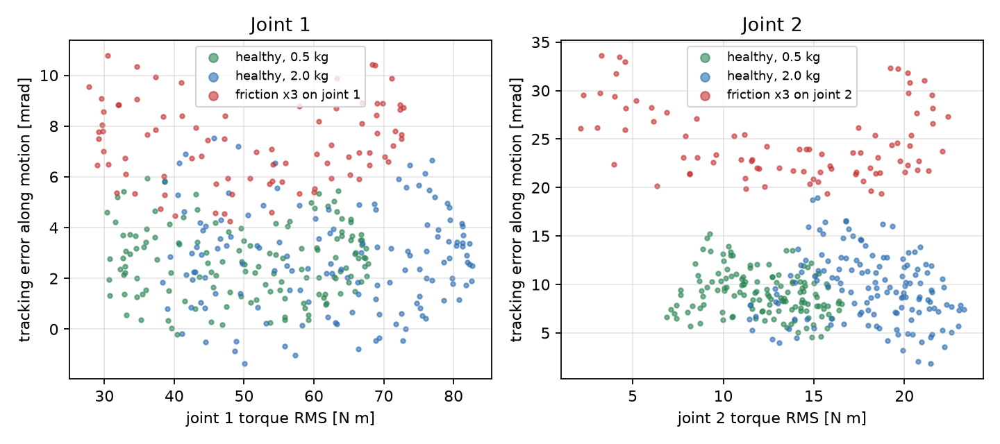

*Figure: torque RMS against direction-weighted tracking error for 1 s windows from recorded demo runs. A heavier payload shifts windows right; tripled friction shifts them up.*

The model is a Random Forest (scikit-learn 1.9.1). Best parameters on validation (average precision = 0.927): `{'n_estimators': 200, 'max_depth': None, 'min_samples_leaf': 2, 'max_features': 'sqrt', 'class_weight': None}`, out of 32 configurations. Windows whose label changes inside them are dropped from training. Score threshold: 0.4. The alarm turns on after 8 consecutive positive windows and off after 5 consecutive negative ones. Both were chosen on validation to maximise F1 subject to ≤ 0.5 false alarms per minute. `predict_proba` is treated as a **model score**, not a calibrated probability.

**Baseline:** score = max_j(RMS position error of joint j / reference_j). The reference is the 95th percentile on healthy training windows (0.0095 and 0.0166 rad). Window 0.5 s, threshold x1.1, alarm after 8 consecutive windows. The baseline uses the same validation procedure and alarm rule as the Random Forest.

*Note:* the selected alarm persistence lies at the edge of the search grid ([1, 3, 5, 8]). A wider grid might give a different result. This is reported rather than changed after seeing test results.

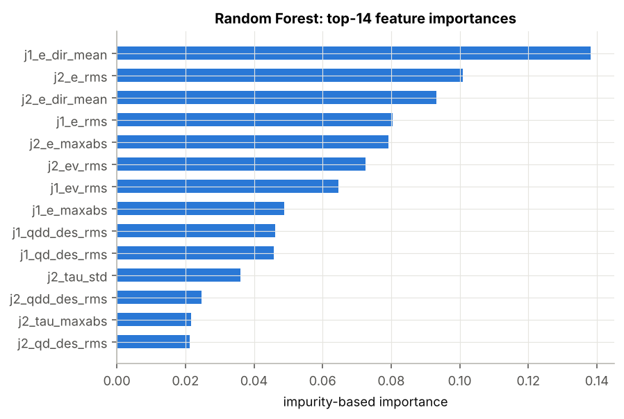

*Figure: impurity-based feature importance of the Random Forest.*

## 6. Evaluation design

- Runs are split by experiment group (60/20/20, stratified by scenario), and the split file is written before training. All choices of features, parameters and thresholds use train/validation only.
- The regular test and the stress test are reported separately, never averaged.
- Monitoring starts after 2.0 s (end of the smooth start). Before that the interface shows WARMING UP.
- One alarm = one off-to-on transition of the alarm state. A false alarm is an alarm that starts before the fault is injected. False alarms are divided by minutes of healthy operation.
- Delay = time of the first valid alarm − defined fault time (label switch). A false alarm that started earlier and is still on does not count as a detection. For gradual faults, an alarm that starts after friction begins rising and is still on when the label switches counts as an early detection with zero delay.
- Window-level metrics (precision/recall/F1) compare the alarm state with the label on every window, including transitions. That is why window recall is lower than the run-level detection rate: windows inside the detection delay count as misses.

## 7. Results

RF = Random Forest; raw F1 = F1 of per-window decisions before the persistence rule.

### 7.1 Regular test (in range)

48 runs, 9.7 minutes of healthy operation and 32 faulty runs.

| Detector | Precision | Recall | F1 | Raw F1 | False alarms /min | Healthy runs with FA | Detected | Missed | Median delay [s] | P90 delay [s] | Max delay [s] |
|---|---|---|---|---|---|---|---|---|---|---|---|
| RF | 0.99 | 0.69 | 0.82 | 0.86 | 0.21 | 0/16 | 32/32 | 0 | 1.5 | 4.3 | 11.2 |
| Baseline | 0.99 | 0.28 | 0.43 | 0.54 | 0.31 | 0/16 | 16/32 | 16 | 2.7 | 7.6 | 11.6 |

### 7.2 Stress test (held-out conditions)

60 runs, 12.4 minutes of healthy operation and 40 faulty runs.

| Detector | Precision | Recall | F1 | Raw F1 | False alarms /min | Healthy runs with FA | Detected | Missed | Median delay [s] | P90 delay [s] | Max delay [s] |
|---|---|---|---|---|---|---|---|---|---|---|---|
| RF | 0.49 | 0.69 | 0.57 | 0.59 | 3.88 | 15/20 | 26/40 | 14 | 1.8 | 4.3 | 9.2 |
| Baseline | 0.38 | 0.41 | 0.39 | 0.44 | 2.83 | 14/20 | 17/40 | 23 | 3.5 | 11.0 | 15.4 |

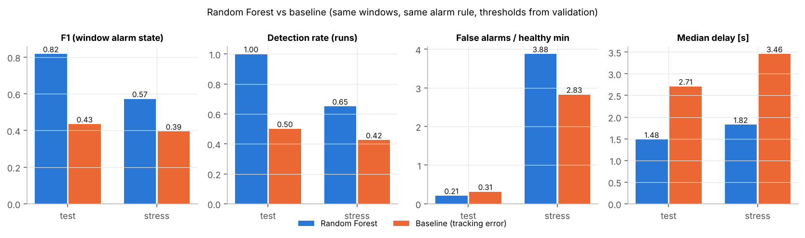

*Figure: Random Forest against the baseline on test and stress.*

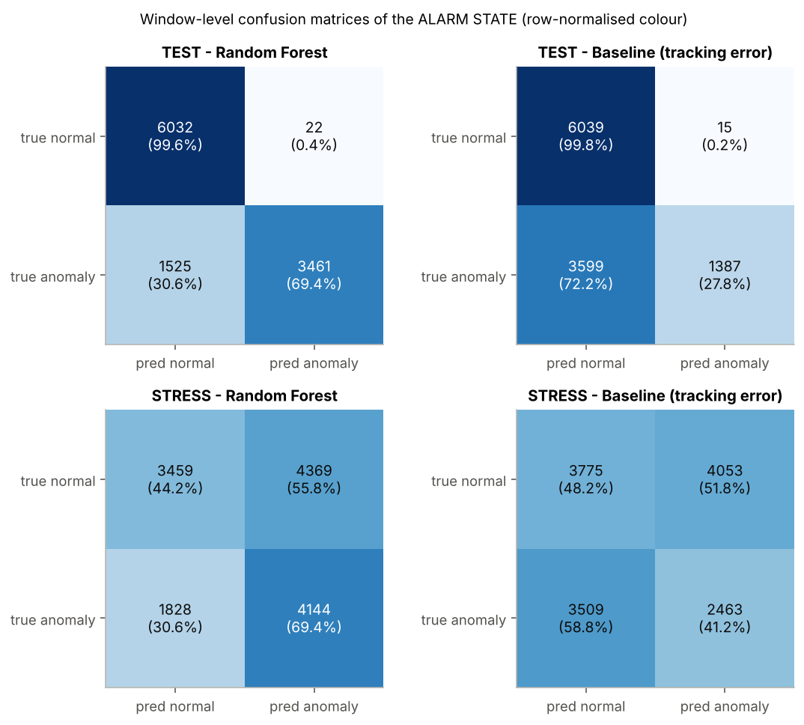

*Figure: window-level confusion matrices (alarm state).*

### 7.3 By fault level and joint

**TEST**

| Scenario | Runs | RF detected | RF median delay [s] | RF false alarms | BL detected | BL median delay [s] | BL false alarms |
|---|---|---|---|---|---|---|---|
| gradual_j1 | 6 | 6/6 | 3.3 | 0 | 1/6 | 11.6 | 0 |
| gradual_j2 | 6 | 6/6 | 0.5 | 1 | 6/6 | 2.8 | 3 |
| healthy_load | 8 | — | — | 0 | — | — | 0 |
| healthy_speed | 8 | — | — | 0 | — | — | 0 |
| mild_j1 | 6 | 6/6 | 3.2 | 0 | 2/6 | 7.6 | 0 |
| mild_j2 | 6 | 6/6 | 1.8 | 0 | 2/6 | 3.3 | 0 |
| severe_j1 | 4 | 4/4 | 1.0 | 0 | 1/4 | 2.3 | 0 |
| severe_j2 | 4 | 4/4 | 0.9 | 1 | 4/4 | 1.1 | 0 |

**STRESS**

| Scenario | Runs | RF detected | RF median delay [s] | RF false alarms | BL detected | BL median delay [s] | BL false alarms |
|---|---|---|---|---|---|---|---|
| gradual_j1 | 8 | 6/8 | 0.7 | 3 | 6/8 | 3.1 | 2 |
| gradual_j2 | 8 | 6/8 | 2.4 | 3 | 6/8 | 4.6 | 2 |
| healthy_load | 10 | — | — | 12 | — | — | 14 |
| healthy_speed | 10 | — | — | 5 | — | — | 4 |
| mild_j1 | 6 | 4/6 | 3.6 | 8 | 0/6 | — | 2 |
| mild_j2 | 6 | 2/6 | 1.1 | 9 | 1/6 | 2.0 | 5 |
| severe_j1 | 6 | 4/6 | 1.9 | 4 | 0/6 | — | 4 |
| severe_j2 | 6 | 4/6 | 3.0 | 4 | 4/6 | 3.2 | 2 |

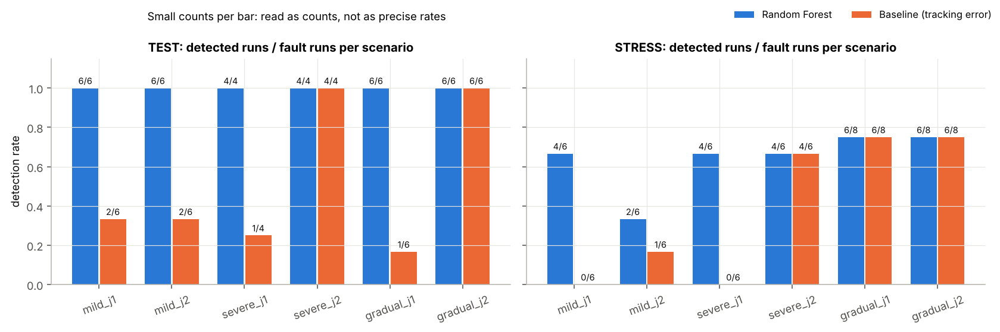

*Figure: detection rate per scenario (label = detected / faulty runs).*

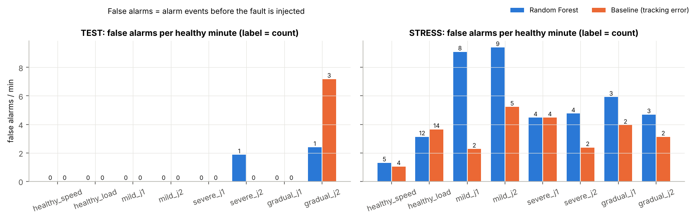

*Figure: false alarms per scenario.*

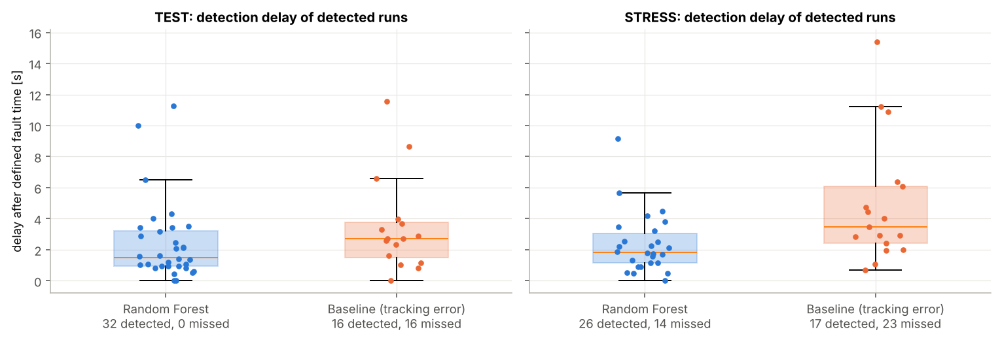

*Figure: distribution of detection delays, with the number of misses.*

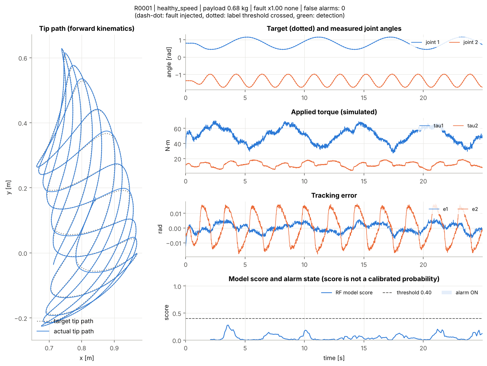

*Figure: test run R0001: trajectory, torque, error and model score.*

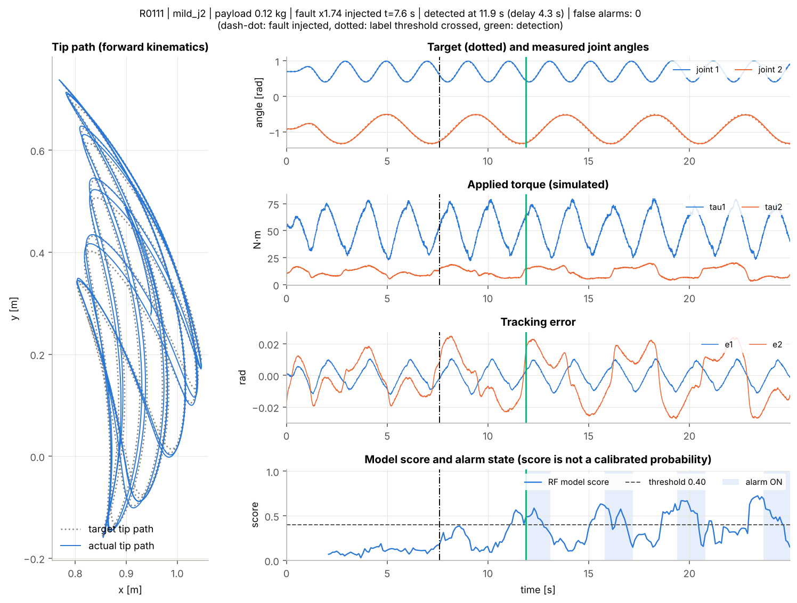

*Figure: test run R0111: trajectory, torque, error and model score.*

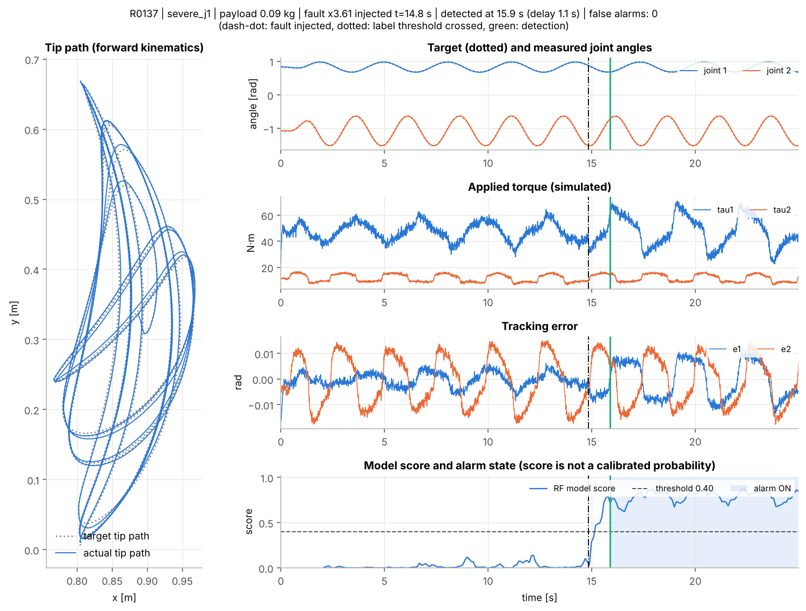

*Figure: test run R0137: trajectory, torque, error and model score.*

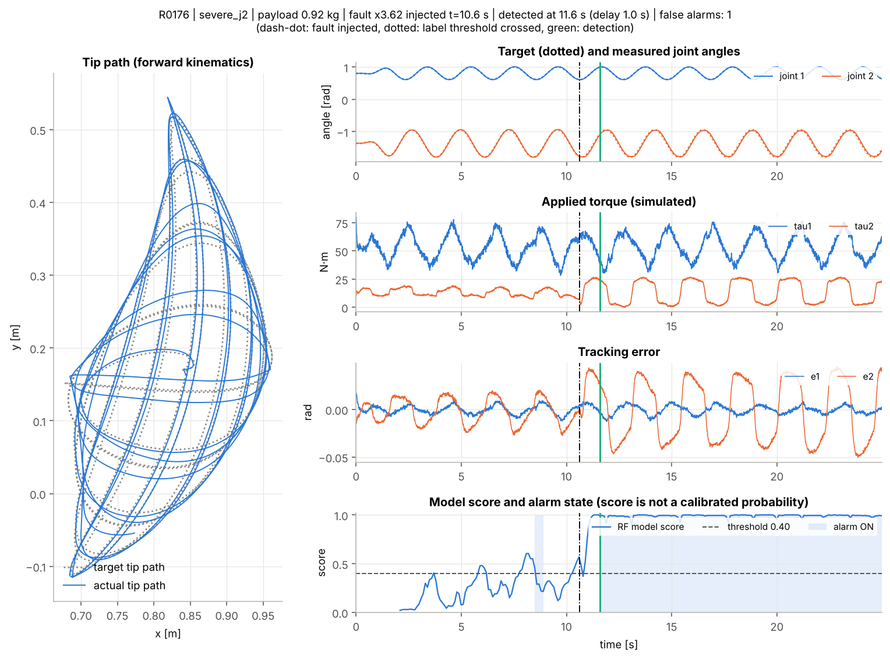

*Figure: test run R0176: trajectory, torque, error and model score.*

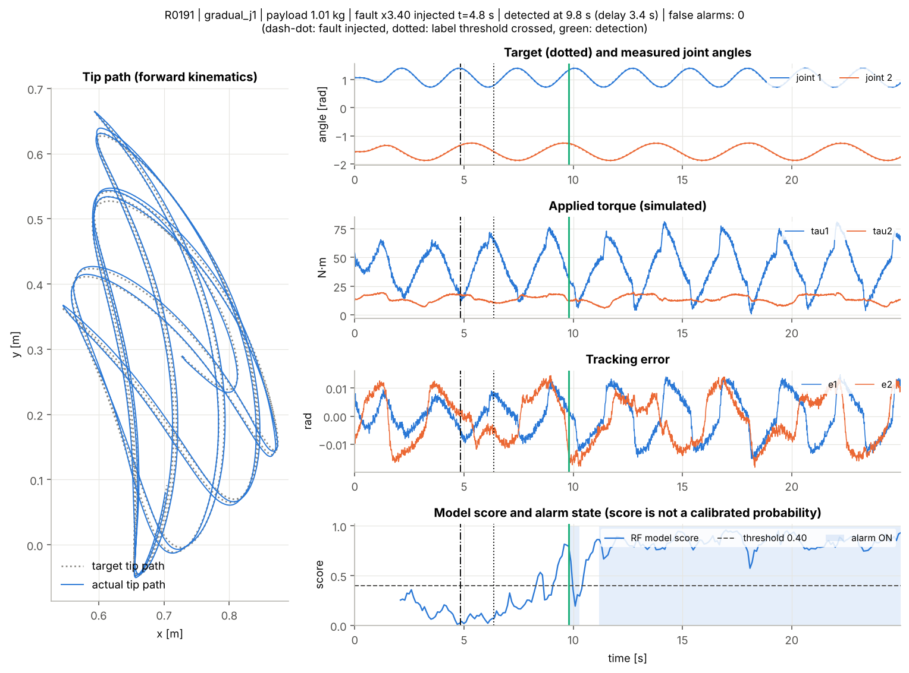

*Figure: test run R0191: trajectory, torque, error and model score.*

## 8. Analysis of false alarms and misses

On the test set the Random Forest raised 2 false alarms, in runs R0176 (severe_j2), R0226 (gradual_j2), and missed 0 faulty runs. The largest test delay was 11.2 s.

*The qualitative remarks below were written when analysing the first standard run; if you re-run with another configuration, check them against the tables (which update automatically).*

Stress test by trajectory type (2–3 kg payload in both):

| Detector | Trajectory | Runs | False alarms | Detected |
|---|---|---|---|---|
| rf | p2p | 32 | 18 (3.44/min) | 26/26 |
| rf | sinusoid | 28 | 30 (4.20/min) | 0/14 |
| baseline | p2p | 32 | 3 (0.57/min) | 17/26 |
| baseline | sinusoid | 28 | 32 (4.48/min) | 0/14 |

- In range, the Random Forest reaches F1 0.82 against 0.43 for the baseline, and detects 32/32 faulty runs against 16/32. The baseline only sees error size, so to stay quiet on fast healthy motion its threshold must be high, and then it misses most mild faults and faults on joint 1 (table 7.3). The Random Forest also uses target motion and error along the motion direction, so it separates the two cases better within the training range.
- Out of range (stress) both methods degrade clearly. The Random Forest has 3.88 false alarms per healthy minute, and 15/20 healthy runs have at least one. Heavier loads and faster motion than seen in training are mistaken for friction. This is a direct, negative answer to the 'avoid false alarms under heavier load' part of the question when the load leaves the training range.
- For faults on sinusoidal stress trajectories, an alarm that was already on before the fault is not counted as a detection, so the low detection count there mostly reflects long false alarms, not faults the model 'did not see'.
- With a high false-alarm rate, some 'detections' after the fault may be coincidence, so stress detection rates should be read together with false-alarm rates.
- Small samples: each test scenario has only 4–8 runs. One or two runs change the rates noticeably, and no confidence intervals were computed.

## 9. Diagnosis: which joint, and how much

Once the alarm is on, a diagnosis stage answers two questions: which joint is faulty, and what its friction multiplier is relative to the healthy value (for example the interface shows `Joint 2 - friction increase: 200% (x3.0)`). It never decides whether there is a fault; that remains the detector's job.

- Two Random Forests (joint classifier, friction-multiplier regressor) use the same 24 features as the detector and reuse its hyper-parameters; there is no separate tuning step.
- Trained only on label-1 training windows (13027 windows, true multiplier x1.62–4.00). Targets come from ground truth (faulty joint from the manifest, multiplier from `truth/`) and are never inputs.
- Online, predictions are averaged over at most the 20 most recent windows scoring ≥ the threshold, and shown only while the alarm is on. The buffer is cleared when the alarm turns off.
- Validation (per window, for reference only): right joint 85.7%, mean absolute multiplier error 0.42.
- Test and stress data were first examined after the diagnosis stage was trained.

Run-level evaluation, matching what the system shows: only faulty runs the detector caught, reading the diagnosis at the detection window and some time later (only if the alarm is still on).

| Set | When | Right joint | Median abs. multiplier error | P90 abs. multiplier error |
|---|---|---|---|---|
| test | alarm turns on | 30/32 | 0.36 | 0.68 |
| test | 2 s later | 23/23 | 0.20 | 0.64 |
| stress | alarm turns on | 23/26 | 0.53 | 1.19 |
| stress | 2 s later | 14/17 | 0.57 | 0.84 |

Per window (all label-1 windows): test right joint 94.5%, multiplier MAE 0.28; stress 77.6%, MAE 0.65.

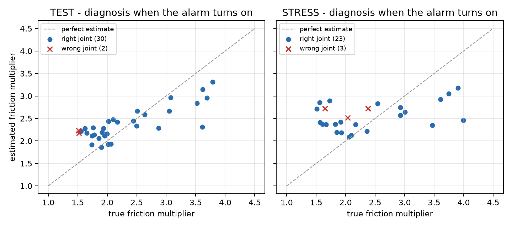

*Figure: estimated against true friction multiplier at the moment the alarm turns on.*

- Wrong joints on the test set at the moment of the alarm: R0225 (gradual_j2, true multiplier x1.51), R0226 (gradual_j2, true multiplier x1.52).
- The median test error at the alarm is 0.36: for example an estimate of x2.6 when the truth is x3.0 (reported +164% instead of +200%). The ±15% healthy variation is below this resolution, so the system cannot measure changes that small.
- Estimates are pulled toward the middle of the training range: small increases near x1.5 are overestimated and the largest ones are underestimated. The estimate separates moderate from severe faults; it is not a precise measurement.
- On a false alarm the diagnosis still names a joint and a friction level, and both are wrong. The diagnosis is only as trustworthy as the alarm before it.
- The diagnosis gives a joint and a friction level, not a physical cause.

## 10. Limitations

- 100% simulated data, not validated on a real robot. Simple physics (rigid links, no detailed motor/gearbox, no backlash, no temperature effects).
- Increased friction is only one way to model an abnormality. It does not show that the only cause is lost lubrication, and the system does not identify causes.
- One fault type, on one joint at a time. No simultaneous faults on both joints and no other faults (collisions, sensor offsets, gear wear).
- The controller knows the exact nominal robot parameters; only the declared payload is slightly off.
- The standard dataset size does not guarantee generalisation. The stress test shows the model does not generalise beyond the trained payload and speed range.
- Random Forest scores are not calibrated probabilities.
- Anomaly detection is not prediction of time to failure or remaining useful life (RUL).

## 11. Next steps

- Add the declared payload, or the model residual (measured torque minus torque predicted by the nominal dynamics), as features to reduce confusion between heavy load and friction. Then re-evaluate on a new stress set, because the current one has already been examined.
- Widen the training range (payload, speed, trajectory types), or add out-of-distribution detection so the system says 'uncertain' instead of raising an alarm.
- Model motors and gearboxes (current, gear ratio, efficiency) and compare with real robot data if possible.
- Estimate friction online (system identification) to follow trends. Only with long-term degradation data should remaining-life prediction be discussed.
- Add bootstrap confidence intervals by experiment group and GroupKFold cross-validation on the development set.

## Appendix: reproducibility

Seed: 20261024. Versions: Python 3.13.17, NumPy 2.5.4, pandas 3.1.0, scikit-learn 1.9.1. Full re-run: `python -m scripts.run_pipeline --mode standard` (see README).
